  <picture>
    <source media="(prefers-color-scheme: dark)" srcset="./dark.svg">
    <source media="(prefers-color-scheme: light)" srcset="./light.svg">
    
  </picture>

<h2 align="center">Hi, I'm Trupti 👋</h2>

  Computer Science student at PMEC · Aspiring Software Development Engineer

I'm interested in software engineering, AI/ML, problem-solving, and building useful projects while continuing to strengthen my fundamentals.

- 🔭 **Currently building:** Sign Language Recognition
- 🧠 **Focusing on:** AI/ML, Data Structures & Algorithms, and open-source contributions
- 💻 **Languages:** C, Java, Python, JavaScript; TypeScript appears in my repository language statistics
- 🛠️ **Tools:** GitHub, Windows Terminal, Canva, and Figma
- 📫 **Email:** [truptimayeesuar@gmail.com](mailto:truptimayeesuar@gmail.com)
- 📸 **Instagram:** [@truptiiii_1203](https://www.instagram.com/truptiiii_1203/)

---

## Featured Project

### 🤟 Sign Language Recognition
A project in progress exploring sign language gesture recognition and accessible human-computer interaction.

> Add the repository link, implementation details, libraries, screenshots, and measured results when they are available.

---

## GitHub Stats

<!-- Replace YOUR_GITHUB_USERNAME after confirming your exact GitHub username. -->

---

  <i>Building consistently. Learning continuously. Shipping better projects.</i>

